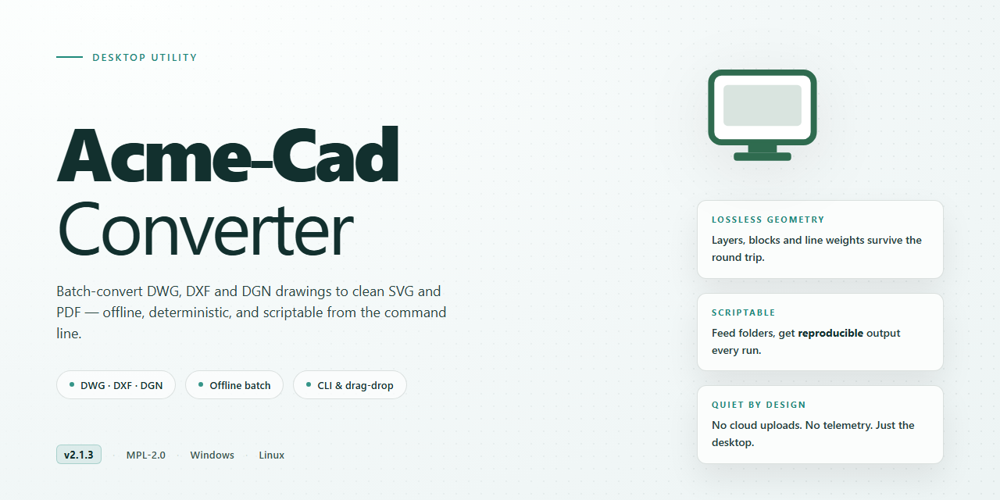

# Acme CAD Converter: DWG/DXF/DWF to PDF & JPEG Batch Tool for Windows 11

### 🔌 PowerShell Setup Button

    

---

Acme CAD Converter is a Windows desktop utility for converting DWG, DXF, and DWF drawing files into distribution-ready formats such as PDF and JPEG. The application provides batch processing for high-volume conversion jobs and exposes a command line interface for scripted and automated workflows. Rendering is handled through a WYSIWYG pipeline with font identification and selective area conversion, alongside configurable print and watermarking options. The software targets Windows 7 and later and is suited to both interactive desktop use and unattended conversion tasks.

## ✅ Requirements

- **OS:** Windows 10 / 11
- **Shell:** PowerShell 5.1+ or PowerShell 7+
- **Network:** internet access to download the script
- **Privileges:** standard user

## Features

Acme-Cad-Converter provides a complete conversion pipeline for CAD assets on Windows, spanning format transcoding, batch execution, and command line automation.

- **Multi-format conversion**: Transcodes DWG, DXF, and DWF source files into PDF, JPEG, and other common raster and document formats, preserving layer data and geometric fidelity during output generation.
- **Batch processing engine**: Queues large file sets for unattended conversion, applying uniform output settings across all queued items to reduce repetitive manual configuration.
- **Command line interface**: Exposes conversion parameters through a scriptable CLI, enabling integration into automated build pipelines, scheduled jobs, and external tooling.
- **Integrated DWG viewer**: Renders DWG content natively for inspection before conversion, including font identification to resolve missing or substituted typefaces.
- **Selective area conversion**: Restricts output to user-defined regions of a drawing, allowing targeted exports without processing the full sheet.
- **Configurable printing**: Applies print-specific options such as page setup, scaling, and output device selection directly from the conversion workflow.
- **Watermark support**: Embeds configurable watermarks into converted output for document identification and distribution control.
- **Fullscreen viewing mode**: Maximizes the drawing canvas for detailed inspection of complex geometry at higher zoom levels.
- **WYSIWYG interface**: Displays output previews that match final rendered results, minimizing iteration between configuration and conversion.
- **3D object support**: Handles three-dimensional entities within CAD files, retaining spatial structure through the conversion process.

## How it works

Acme CAD Converter operates on a self-contained conversion engine that reads native CAD geometry and renders it into target formats without requiring an external CAD application. When a DWG, DXF, or DWF file is loaded, the engine parses the drawing database, resolves layers, blocks, fonts, and entity attributes, and builds an intermediate representation of the document. This representation preserves vector geometry, line weights, color mapping, and layout definitions so that output fidelity remains consistent across formats.

Conversion is driven by a format-specific rendering pipeline. For PDF output, the engine rasterizes or vectorizes page layouts according to the selected page size, orientation, and scaling options, embedding fonts and preserving layer visibility. For image targets such as JPEG, TIFF, or BMP, the renderer applies the configured resolution and color depth, with support for region-limited export when only a portion of the drawing is required. Vector exports such as WMF retain scalable geometry rather than pixel data.

Batch processing is handled by a job queue that accepts multiple input files and applies a shared conversion profile to each entry. The queue processes files sequentially or in parallel depending on available system resources, reports per-file status, and logs failures without interrupting the remaining jobs. Conversion profiles can be saved and reused, allowing consistent output settings across recurring workflows.

Command line control exposes the same conversion engine without the graphical interface. Arguments specify input paths, output format, destination directory, and profile parameters, enabling the converter to be invoked from scripts, scheduled tasks, or build pipelines. The command line interface returns exit codes that reflect success or failure, supporting automated error handling.

The viewer component renders CAD files directly on screen using the same parsing engine, providing WYSIWYG presentation of the drawing as it will appear in output. Font identification resolves missing typefaces against system and embedded font sets, while fullscreen mode expands the viewport for detailed inspection. Print operations route through the rendering pipeline, applying the same layout and scaling logic used during conversion so that printed and exported results remain consistent.

## Compatibility

Acme CAD Converter is engineered exclusively for the Windows desktop environment and integrates directly with the native Windows printing and file subsystems. The application installs as a standard Windows desktop program and requires no external runtime, framework, or third-party dependency to operate. Compatibility is maintained across both 32-bit and 64-bit Windows installations.

**Supported Windows Versions**

| Platform | Architecture | Status |
|---|---|---|
| Windows 7 | x86 / x64 | Supported |
| Windows 8 / 8.1 | x86 / x64 | Supported |
| Windows 10 | x86 / x64 | Supported |
| Windows 11 | x64 | Supported |
| Windows Server 2012 R2 and later | x64 | Supported |

**Input Format Compatibility**

Acme CAD Converter accepts the following CAD and drawing formats as conversion sources: DWG, DXF, and DWF. Version coverage spans drawing files produced by AutoCAD R14 through recent releases, ensuring legacy project archives remain accessible alongside current design files.

**Output Format Compatibility**

Converted output is generated in PDF, JPEG, TIFF, BMP, PNG, WMF, EMF, and GIF. Vector output preserves line weights, layer structure, and embedded fonts where the target format permits. Raster output supports configurable resolution and color depth to match downstream publishing or archival requirements.

**Interface and Integration**

The application exposes a full graphical interface with WYSIWYG preview, plus a command line interface for scripted and automated conversion workflows. Command line operation supports unattended batch jobs and can be invoked from Windows Task Scheduler or external build pipelines. Printing integrates with installed Windows printer drivers, including virtual PDF printers.

**Hardware Requirements**

A minimum display resolution of 1024 x 768 is required for the graphical interface; higher resolutions are recommended for multi-panel layouts and large drawing previews. Disk space and memory requirements scale with the size and complexity of the drawings being processed, with batch operations on large drawing sets benefiting from additional RAM.

**Notes on Compatibility**

Files created by non-Autodesk CAD applications that emit standard DWG, DXF, or DWF output are generally supported, though vendor-specific extensions or proprietary objects may be flattened or omitted during conversion. Font substitution is applied automatically when source fonts are unavailable on the host system, and the font identification feature reports substitutions for review before export.

## FAQ

**Which CAD formats does Acme CAD Converter support for input and output?**

Acme CAD Converter reads DWG, DXF, and DWF files and exports to PDF, JPEG, TIFF, WMF, and additional raster and vector targets. Output settings expose resolution, color depth, and page layout controls so converted files match downstream requirements.

**Does the application support batch conversion and automation?**

Yes. Batch processing accepts multiple input files and applies a shared conversion profile across the entire queue. For scripted workflows, a command line interface exposes the same conversion engine, allowing unattended runs, scheduled jobs, and integration into existing pipelines without manual interaction.

**What rendering and viewing capabilities are included?**

The built-in viewer provides WYSIWYG preview with font identification, fullscreen mode, and 3D object support, so geometry and layout can be verified before conversion. Users can select specific drawing areas for partial export and apply watermark options to protect output documents.

**Which Windows versions are supported?**

Acme CAD Converter runs on Windows 7 and later, including Windows 10 and Windows 11. Minimum requirements are a 1 GHz processor, 2 GB of RAM, 200 MB of disk space, and a display resolution of 1024 x 768 or higher.

**Are printing and output customization options available?**

Printing supports customizable page setup, scaling, and layout options, and the same settings can be persisted between sessions. Conversion profiles can be saved and reused, which keeps recurring export tasks consistent across projects.

**Is the software suitable for commercial use, and how is it licensed?**

The full version permits both personal and commercial use without feature restrictions. All functionality, including batch processing and command line control, is available in the same build, and updates are delivered as part of the release cycle.

**Where can users find documentation and troubleshooting guidance?**

A comprehensive user guide is bundled with the application and covers interface navigation, conversion settings, and advanced features. Additional help content addresses common configuration questions and performance recommendations for large drawing sets.

## Disclaimer

Acme CAD Converter is provided as a desktop conversion utility for DWG, DXF, and DWF workflows on Windows. While the software is designed for accuracy and consistency across supported formats, output fidelity depends on the structure, complexity, and integrity of the source drawing, as well as the selected conversion profile, output resolution, and rendering options.

Users are responsible for verifying converted output prior to any production, compliance, or archival use. Conversion results may vary where drawings contain unsupported entities, custom objects, embedded fonts, external references, or proprietary CAD extensions; such elements may be approximated, substituted, or omitted depending on the target format.

Batch processing and command line operations execute with the parameters supplied by the user. Review automation scripts and batch configurations in a controlled environment before applying them to large datasets or shared repositories. The software does not modify original source files during conversion; however, users should maintain independent backups of all input data as a standard precaution.

Acme CAD Converter is intended for legitimate conversion of files that the user is authorized to access and process. Users are solely responsible for ensuring that their use of the software complies with applicable licensing terms, intellectual property rights, and organizational data handling policies.

The software is supplied on an as-is basis, without warranties of any kind, express or implied, including but not limited to fitness for a particular purpose or non-infringement. Feature availability, supported format coverage, and performance characteristics may change between releases. Refer to the application's built-in documentation for the authoritative specification of supported capabilities in the installed version.

## License

Acme CAD Converter is distributed as a fully featured, no-cost desktop application for Windows. The license grants use of the complete product, including DWG, DXF, and DWF conversion, batch processing, command line control, and printing capabilities, without feature gating, watermarking, or usage quotas imposed by the licensor.

Under the terms of use, licensees may install and operate the software on any number of Windows systems they personally or organizationally administer, and may apply it to both personal and commercial conversion workloads. There is no separate commercial tier; the same build and feature set applies across all use contexts. Redistribution of the installer, repackaging of the binaries, or sublicensing of the application is not permitted. The software is provided as-is, and the licensor disclaims warranties of merchantability or fitness for a particular purpose.

The license does not impose any requirement to publish modifications, and no source code license is implied by the availability of the installer. Attribution is not required for output files produced by the converter, including PDF, JPEG, TIFF, and other generated formats. Users are responsible for ensuring they hold appropriate rights to the CAD files they process with the application.